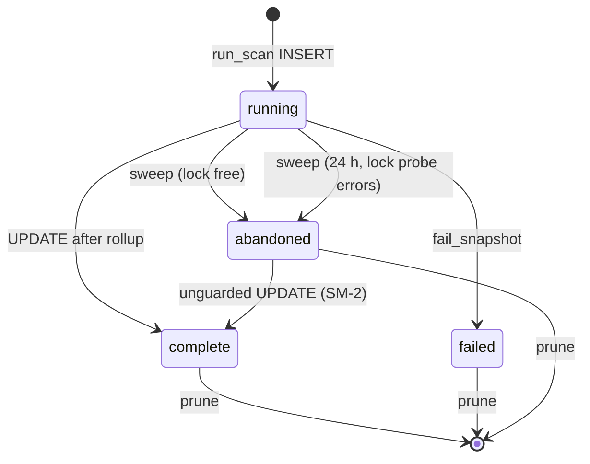
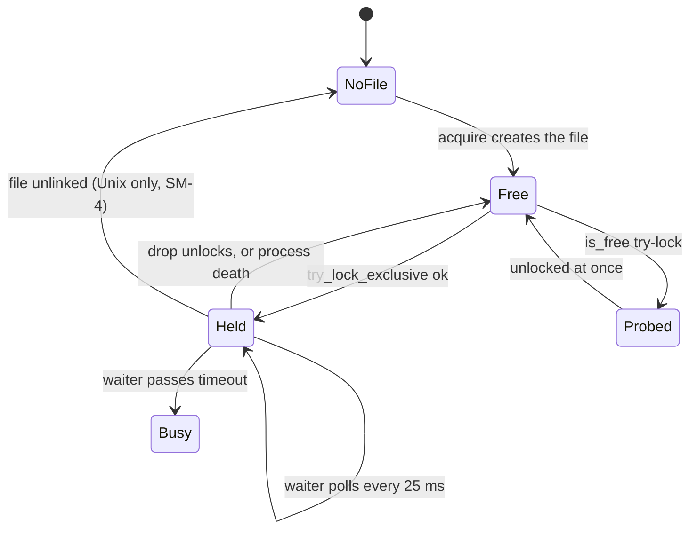
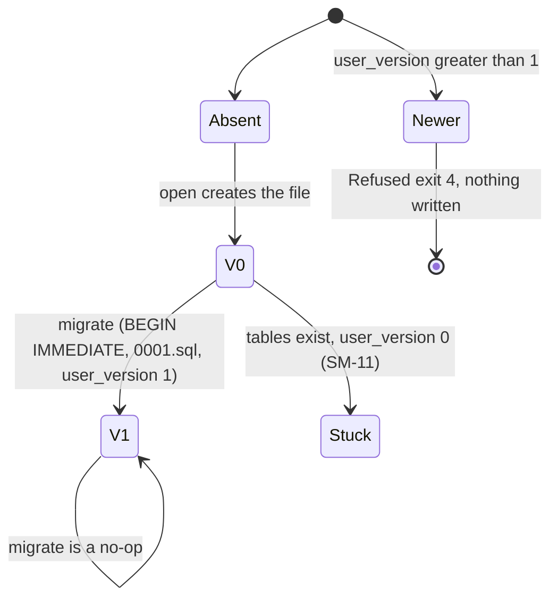
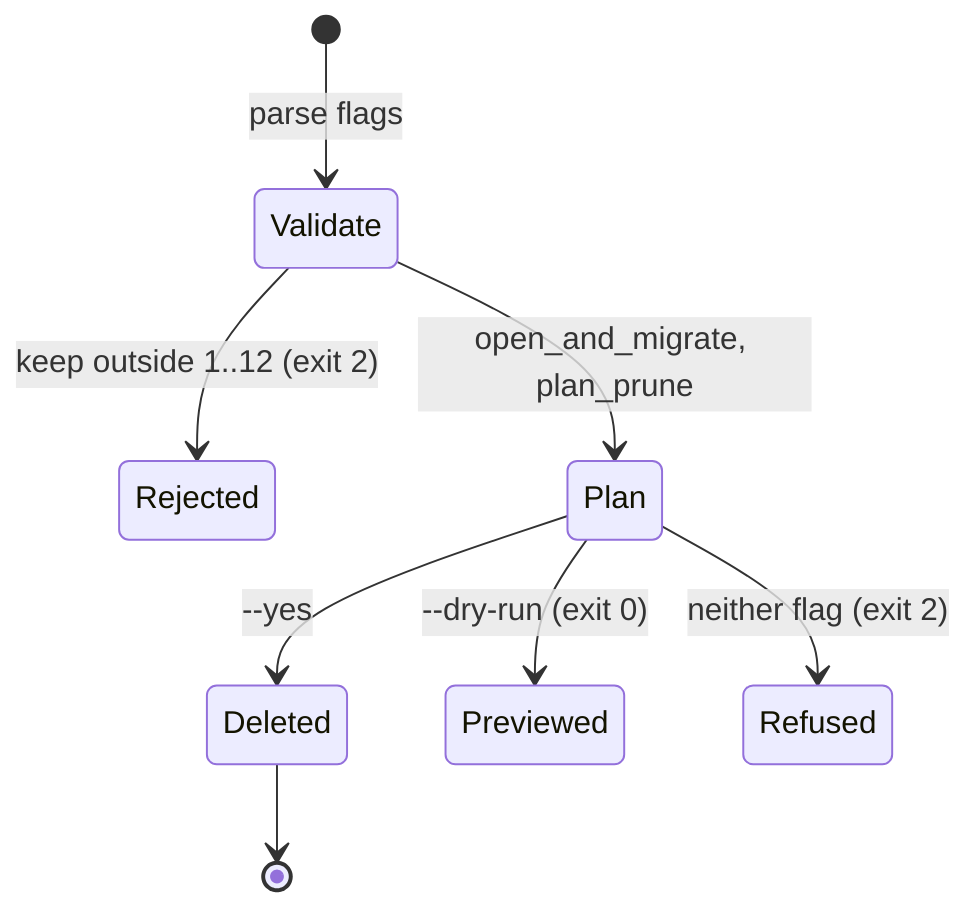
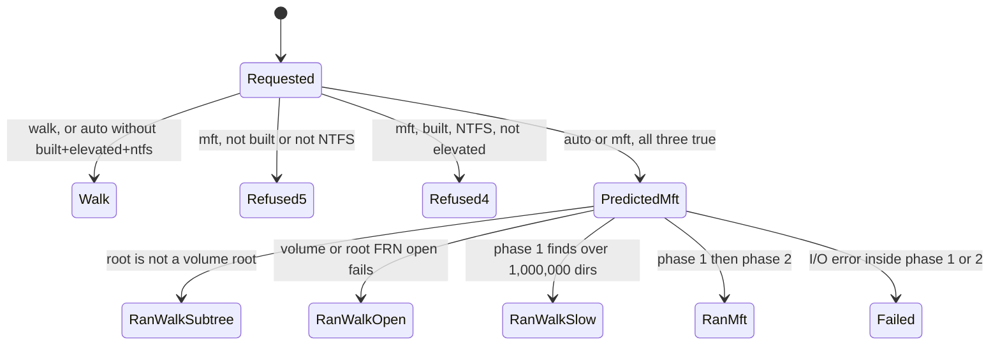
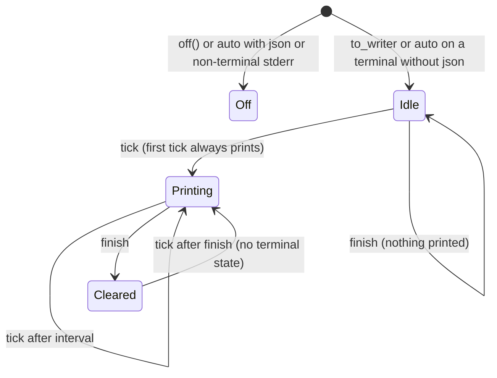

# Arkos state machines

This document records the state machines that the code implements without naming them, and the
defects found by walking each transition. It was written against `src/` as of branch
`claude/upbeat-dijkstra-u4yyk4` (commit 93f224c, one test commit after c29ddc0). Line numbers
point at that tree. Reproducing tests live in `tests/state_machines.rs`; each defect test carries
`#[ignore = "defect SM-N: ..."]` and fails when run with `--ignored`.

Reading guide: a "guard" is a condition the code checks before a transition. "Unguarded" means the
code performs the transition without checking the state it assumes.

## Status after the fixes

The sections below describe the machines as found in Phase A. Phase B fixed these findings, and
their tests in `tests/state_machines.rs` now run without `#[ignore]`: SM-1, SM-2, SM-3, SM-5,
SM-6, SM-7, SM-8, SM-9, SM-10, SM-11, SM-12, S-1, S-3 and S-8. Where a table below still shows the
old behaviour, the fix is:

- SM-1: under its own volume lock a scan marks every `running` row for the volume `abandoned`
  (`finished_at` set, `abandoned_dead_scan` logged) and proceeds.
- SM-2: the completion UPDATE has `AND state = 'running'`; a row count other than 1 returns
  `Refused` ("snapshot N left the running state during the scan") and no success is reported.
- SM-3: `list`, `top`, `diff`, `tree`, `status` and `db info` use `db::open_read`, which never
  migrates, sweeps, creates the file or takes the write lock. A missing ledger is an empty list or
  status, and exit 3 for `top`, `diff` and `tree`. `migrate` checks `user_version` first and takes
  `BEGIN IMMEDIATE` only when it has to migrate. `scan`, `prune`, `db migrate` and `db vacuum`
  stay writable and sweep. Because the read verbs no longer sweep, `status --probe` counts a
  `running` row only while its lock is held.
- SM-5: lock keys fold case for drive letters and volume GUID paths, and for `dir:` keys only on
  Windows.
- SM-6 and SM-8: `volumes::volume_key` is the one place a volume argument becomes a key; `scan`,
  `list --volume` and `prune --volume` all use it. Directory keys use the canonical absolute path.
- SM-7: `diff` returns `Refused` naming both roots when they differ.
- SM-9: `failed` and `abandoned` rows are always prune candidates; `running` never is.
- SM-10: the WAL switch retries every 25 ms within the busy timeout.
- SM-11: tables present with `user_version` 0 is `Refused` (exit 4), reason
  `ledger.inconsistent: tables present but user_version is 0`.
- SM-12: the walk ticks after a directory's files are counted.
- S-1: `diff`, `top` and `tree` read inside one `BEGIN DEFERRED` transaction (`db::read_tx`). The
  test builds its seam on `read_tx` itself, with a prune between two reads; `diff` has no hook of
  its own.
- S-3: the progress line is cleared with `\r`, space padding to the widest line printed, and `\r`.
- S-8: `--mode mft` returns `Unsupported` (exit 5) when the volume cannot be opened or the
  directory map passes the limit. Only `--mode auto` falls back to the walk. Windows only, so
  unexecuted here.

## Deferred

| ID | Reason |
|---|---|
| SM-4 | Needs a deliberate unlink of the lock file; a fix needs an inode recheck loop after locking. Its test stays `#[ignore]`. |
| S-2 | Predicted mode on failed and abandoned rows shows only on Windows and is cosmetic. |
| S-4 | A race of microseconds with no deterministic seam; only matters with `busy_timeout_ms = 0`. |
| S-5 | Needs `AUTOINCREMENT`, which is a schema change and schema 0001 is frozen. |
| S-6 | The spec requires refusing a newer `user_version`. |
| S-7 | Needs a long cascade delete; not deterministic in a test. |
| S-9 | Cosmetic: abandoned `finished_at` is the sweep time. |
| S-10 | Needs a hung process and a heartbeat design. |

## 1. Snapshot lifecycle (`arkos_snapshots.state`)

The `state` column has a CHECK constraint for `running`, `complete`, `failed`, `abandoned`
(`src/db/0001.sql:337`). A partial unique index allows one `running` row per `volume`
(`0001.sql:348`).

| From | To | Trigger | Code | Guards | Missing or unguarded |
|---|---|---|---|---|---|
| none | running | `run_scan` inserts the row | `src/scan/mod.rs:159-171` | volume lock held (138); no `running` row for the volume (140-152); mode resolved first (154); unique index | A dead `running` row found here is refused, not swept (SM-1) |
| running | complete | final UPDATE after rollup | `scan/mod.rs:240-262` | scan returned Ok (208-215); rollup returned Ok (232-236) | No `AND state = 'running'`; `rows_affected` unchecked (SM-2) |
| running | failed | `fail_snapshot` after a scan, rollup or completion error | `scan/mod.rs:211, 233, 259`; body `314-334` | one transaction deletes `arkos_files` and `arkos_dirs` rows, then sets `failed` | Result discarded (333). If the transaction fails the row stays `running` until the next sweep |
| running | abandoned | lock-aware sweep on every writable open | `db/retention.rs:243-274`, called from `db/mod.rs:79` | `VolumeLock::is_free` true (259); UPDATE re-checks `state = 'running'` (267) | Leaves the partial `arkos_dirs` and `arkos_files` rows in place; `finished_at` is the sweep time, not the death time |
| running | abandoned | 24 h fallback when the lock probe errors | `retention.rs:261` | `started_at < now - 24 h` | Only reached when the lock file cannot be opened for a reason other than "not found" |
| complete, failed, abandoned | deleted | `prune --yes` | `retention.rs:366-379`, plan `294-361` | partition and rank rules in section 4 | `running` is never a candidate (302) |
| abandoned | complete | the original scan was still alive and finishes | `scan/mod.rs:240` | none | Reachable only if a sweep misjudged a live scan (see SM-2 and SM-4) |

Terminal states: `complete`, `failed` and `abandoned` have no outgoing transition except deletion.
`running` never leaves while its owner is alive and hung, because there is no heartbeat (S-10).

What each consumer accepts:

| Consumer | Accepts | Code |
|---|---|---|
| `diff` | `complete` for both ids, same `volume` | `src/diff.rs:50-84` (root is not compared, SM-7) |
| `top` | `complete` | `src/top.rs:36-53` |
| `tree` | `complete` (a missing and a non-complete id produce the same message) | `src/tree.rs:105-117` |
| `status --probe` | any `running` row gives exit 6, then the newest `complete` row's `denied` decides 3 or 0 | `src/probe.rs:103-122` |
| `list` | every state | `src/cli.rs:478-519` |

Unreachable or impossible states that the schema still permits: `complete` with `finished_at`
NULL, `running` with `finished_at` set, `failed` with non-zero counters. None is produced by the
code today.

Crash points in a scan, in order. Each row says what a SIGKILL at that point leaves behind.

| Point | Left behind | Outcome |
|---|---|---|
| after lock, before INSERT | nothing | clean |
| after INSERT | `running` row, no data | swept to `abandoned` |
| inside the walk, between batch commits (`scan/walk.rs:472-474`) | `running` row, committed batches | swept to `abandoned`; partial rows stay |
| after walk, before rollup | full rows, zero rollup | same |
| inside rollup, between chunk commits (`rollup.rs:52-66`) | partly rolled-up sums | same |
| after rollup, before the final UPDATE | complete data, state `running` | swept to `abandoned`, data stays but is never diffable |
| after the final UPDATE | finished snapshot | clean |

## 2. Volume lock

The lock is one file per volume key, `<home>/locks/volume-<fnv64 of upper-cased key, 12 hex>.lock`
(`src/lock.rs:115-127`).

| From | To | Trigger | Code | Notes |
|---|---|---|---|---|
| NoFile | Free | `acquire` opens with `create(true)` | `lock.rs:24-33` | |
| Free | Held | non-blocking exclusive lock succeeds | `lock.rs:37-38`, Unix `183-189`, Windows `130-160` | holder JSON is then written at offset 0 (63-73), write errors ignored |
| Held | Busy (error exit 6) | deadline passes while the lock returns "would block" | `lock.rs:39-50` | the message reads the holder file, which can name a previous holder if the winner has not truncated yet |
| Held | Free | `Drop` unlocks | `lock.rs:108-112` | `let _lock` at `scan/mod.rs:138` keeps it for the whole scan |
| Held | Free | process death | OS | Unix: kernel closes the descriptor. Windows: the handle closes with the process |
| any | Probed | `is_free` | `lock.rs:81-105` | `NotFound` returns free (86); other open errors return `Err` and send the sweep to the 24 h rule |
| Probed | Free | immediate unlock | `lock.rs:95-96` | a scan that tries the lock during the probe sees "would block" and waits 25 ms, so a zero timeout can fail spuriously (S-4) |

Platform differences:

| | Unix (`flock` via `File::try_lock`) | Windows (`LockFileEx`) |
|---|---|---|
| Scope | whole file, advisory, per open file description | one byte at offset 0x4000_0000, per handle |
| Same-process second open | conflicts | conflicts |
| Unlinking the held file | allowed; a new `acquire` creates a new inode and also succeeds (SM-4) | refused by the OS while the handle is open |
| Release on death | immediate | immediate, after the kernel closes the handle |
| Case folding | the key is upper-cased, so `dir:/data/A` and `dir:/data/a` collide (SM-5) | matches the filesystem, which is case-insensitive |

Terminal states: none. The lock file is never deleted by Arkos.

## 3. Ledger open and migrate

| Step | Code | Behaviour |
|---|---|---|
| writable open | `src/db/mod.rs:18-70` | creates the directory, opens read-write with create, sets `busy_timeout` and `foreign_keys` |
| version guard | `mod.rs:38-45` | `user_version > 1` returns `Refused` before any pragma that writes |
| journal mode | `mod.rs:47-61` | `auto_vacuum=INCREMENTAL` (result ignored; verified to be 2 on a new ledger), `journal_mode=WAL` must answer `wal`, then `synchronous=NORMAL` and `wal_autocheckpoint=256` |
| read-only open | `mod.rs:62-65` | `query_only`. No CLI verb uses it. A version-0 file passes the guard |
| migrate lock | `mod.rs:84-112` | `BEGIN IMMEDIATE`, re-reads `user_version`, runs `0001.sql` and sets version 1 in the same transaction, else rolls back |
| sweep | `mod.rs:79` | after migrate, on every `open_and_migrate` |

Which verbs open how: every verb that touches the ledger calls `open_and_migrate`
(`src/cli.rs:206, 249, 289, 331, 350, 366, 409, 441, 462, 468`), so `list`, `diff`, `top`, `tree`
and `status` all open writable, take `BEGIN IMMEDIATE` and run the sweep. `paths` and `probe` never
open the ledger.

Two processes opening the same fresh ledger: the loser of the WAL switch gets Busy at once, without
using the 5 s timeout (SM-10). Two processes migrating: the second waits on `BEGIN IMMEDIATE`, then
sees version 1 and skips the script.

A ledger with `user_version` above 1 is terminal for Arkos. DupliCut's migration 0002 sets version
2, so after DupliCut runs, every Arkos verb exits 4 (S-6). The spec requires the refusal
(`docs/spec-m0.md:184-185`).

## 4. Prune

| Step | Code | Behaviour |
|---|---|---|
| flag rules | `cli.rs:99-102` | `--dry-run` conflicts with `--yes` (clap) |
| keep | `cli.rs:362-365` | `--keep` or config `snapshots_keep`, must be 1 to 12 |
| `--yes` | `cli.rs:367-380` | calls `prune_completed`, which runs `plan_prune` and then one autocommit DELETE per candidate (`retention.rs:367-373`) |
| `--dry-run` | `cli.rs:381-403` | prints the plan, exit 0 |
| neither | `cli.rs:405` | prints the plan, then `Error::Cli`, exit 2 |

Planner (`retention.rs:294-361`):

- Rows are `state <> 'running'`, optionally filtered by an exact `volume` string (302), ordered by
  `volume, root, started_at DESC, id DESC`.
- Each `(volume, root)` group is cut after its `keep`th newest `complete` snapshot. Older
  `complete` rows are candidates. `failed` and `abandoned` rows are candidates only if they sort
  older than that cut (352).
- A group with fewer than `keep` complete snapshots has no cut, so none of its `failed` or
  `abandoned` rows can be a candidate (SM-9). With `keep = 0` (library only) everything non-running
  goes.
- DELETE cascades to `arkos_dirs` and `arkos_files` through the foreign keys. An incremental vacuum
  runs only when the freelist exceeds 32 MiB (`retention.rs:381-389`).

Missing: plan and deletes are not one transaction, and prune does not take the volume lock.
Deleting a snapshot that another process is reading is therefore possible (S-1).

## 5. Scan mode resolution

`resolve_mode` is a pure function (`scan/mod.rs:49-67`), called from `ScanMode::as_resolved`
(34-41) before the snapshot row exists. `mft_into_snapshot` (`scan/mft.rs:70-121`) then decides
what runs.

| Requested | Built (Windows + `mft`) | Elevated | NTFS | Root | Resolved at insert | Ran | Recorded at completion |
|---|---|---|---|---|---|---|---|
| walk | any | any | any | any | walk | walk | walk |
| auto | no | any | any | any | walk | walk | walk |
| auto | yes | no | any | any | walk | walk | walk |
| auto | yes | yes | no | any | walk | walk | walk |
| auto | yes | yes | yes | volume root | mft | mft (phases 1 and 2) | mft |
| auto | yes | yes | yes | subtree | mft | walk, log note "mft needs a volume root" | walk |
| auto | yes | yes | yes | volume root, open fails | mft | walk, log note `mft-unavailable` | walk |
| auto | yes | yes | yes | volume root, over 1,000,000 dirs | mft | walk, log note `mft-slow` (phase 1 wrote nothing) | walk |
| mft | no | any | any | any | exit 5 | none | no row written |
| mft | yes | any | no | any | exit 5 | none | no row written |
| mft | yes | no | yes | any | exit 4 | none | no row written |
| mft | yes | yes | yes | as for auto | mft | as for auto | as for auto |

On Linux every build is "not built", so `walk` and `auto` run the walk and `mft` exits 5. The
Windows rows are covered only by the pure `check_ready` and `resolve_mode` unit tests, and the USN
path is unexecuted (`docs/architecture-h1.md`, P6).

Details worth knowing:

- Refusals happen after the lock and the running-row check but before the INSERT (`scan/mod.rs:154`),
  so a refused mode leaves no row.
- The INSERT stores the predicted mode (`scan/mod.rs:166`). The final UPDATE overwrites it with the
  mode that ran (253). A `failed` or `abandoned` row keeps the prediction (S-2).
- `ensure_mft_ready` runs a second time inside `mft_into_snapshot` (`mft.rs:76`), after the row
  exists. If it fails there the row becomes `failed`.
- An I/O error after phase 1 has started does not fall back to the walk. It fails the snapshot.
- `elevated` is recorded from the token whatever mode ran (`scan/mod.rs:155`).

## 6. Progress reporter

| From | To | Trigger | Code | Guard |
|---|---|---|---|---|
| none | Off | `Reporter::off()`; `auto(json)` when `json` is true or stderr is not a terminal | `progress.rs:215, 225-231` | `IsTerminal` on stderr only |
| none | Idle | `to_writer`, `auto` on a terminal | `progress.rs:234, 227` | |
| Idle, Printing | Printing | `tick(files, dirs, bytes)` | `progress.rs:244-264` | sink present; `now - last >= interval` (500 ms default); the first tick has no `last` and prints |
| Printing | Cleared | `finish()` | `progress.rs:267-276` | `printed` true |
| Idle, Cleared | same | `finish()` | `progress.rs:268-270` | nothing printed, so no output |
| Off | Off | any call | `progress.rs:245-247` | sink is `None` |

`run_scan_with_progress` calls `finish` once, before it inspects the scan result
(`scan/mod.rs:201`), so error text on stderr never lands on a half-drawn line. A panic during the
walk skips `finish` and leaves the last progress line on the terminal. The walk calls `tick` after
inserting a directory row and before inserting that directory's files (`scan/walk.rs:448-451`), so
the last directory's files are never reported (SM-12). The line ends with `ESC [ K`; Windows
consoles that have not enabled virtual terminal processing print that sequence literally (S-3).

## Races between processes

| Pair | Interleaving | Result | Verdict |
|---|---|---|---|
| scan and `list` | `list` opens writable, runs `BEGIN IMMEDIATE` while the scan's batch transaction is open | `list` waits up to `busy_timeout_ms`, then exits 6 | SM-3 |
| scan and `list` | `list` sweeps while the scan holds the lock | the live row is kept | correct |
| two scans, same volume | second waits on the lock, exits 6 after the timeout | correct | |
| two scans, same volume, owner of a stale row dies while the second waits | second opened (and swept) before the row existed, takes the lock, sees a `running` row, exits 4 | the next run succeeds | SM-1 |
| two scans, same directory spelled two ways | different volume keys, different locks, two `running` rows | no exclusion | SM-6 |
| scan and prune | prune never lists `running` rows; its deletes need the write lock | safe, but a long cascade delete can make the scan's batch commit fail with Busy | S-7 |
| scan and diff, tree or top | readers check `complete` only | safe | |
| prune and diff | diff validates both ids, then reads in separate statements without a read transaction | a deleted snapshot reads as empty | S-1 |
| sweeper and live scan whose lock file is gone | the sweep abandons the live row; the scan later overwrites it with `complete`, or finds it deleted by a prune | SM-2, SM-4 |

## Defects reproduced by a failing test

Run `cargo test --test state_machines -- --ignored`. Thirteen tests failed when written; only SM-4 is still `#[ignore]` (see Deferred).

| ID | Severity | Where | Summary | Test |
|---|---|---|---|---|
| SM-1 | low | `scan/mod.rs:140-152` | A scan holds the volume lock, so any `running` row for that volume is dead, yet it is refused (exit 4) instead of swept. The sweep ran earlier, at open | `sm1_scan_abandons_a_dead_running_row_it_finds_under_its_own_lock` |
| SM-2 | medium | `scan/mod.rs:240-262` | The completion UPDATE has no state guard and its row count is ignored. A scan whose row was swept and pruned reports success for a snapshot that is gone | `sm2_scan_does_not_report_success_for_a_snapshot_that_vanished` |
| SM-3 | medium | `db/mod.rs:76-85`, `cli.rs:249` and others | Read verbs open writable and take `BEGIN IMMEDIATE`, so they queue behind a scan's write transaction and fail with Busy | `sm3_a_read_verb_can_open_the_ledger_while_a_scan_is_writing` |
| SM-4 | low (Unix) | `lock.rs:24-33, 86` | Unlinking a held lock file lets a second `acquire` succeed, and `is_free` reports a missing file as free, so the sweep can abandon a live scan | `sm4_unlinking_the_lock_file_does_not_admit_a_second_holder` |
| SM-5 | low (Unix) | `lock.rs:116` | The lock key is upper-cased, so `/data/A` and `/data/a` share a lock although their volume keys differ | `sm5_case_distinct_directories_have_distinct_locks` |
| SM-6 | medium | `volumes.rs:71-75` | The `dir:` volume key is the raw argument: a trailing separator, a relative path or a symlink gives a second key for one tree, splitting the lock, the one-running rule, diff and prune partitions. A relative key names a different tree per working directory | `sm6a_...`, `sm6b_dir_volume_key_is_absolute` |
| SM-7 | medium | `diff.rs:78-82` | `diff` compares volumes but not roots, so a subtree snapshot diffs against a full one and reports the rest of the tree as removed | `sm7_diff_refuses_snapshots_of_different_roots` |
| SM-8 | medium | `cli.rs:484-512`, `retention.rs:302` | `list --volume` and `prune --volume` match the stored key (`dir:/x`) and not the spelling `scan --volume` accepted (`/x`); the filter silently matches nothing, so `prune --yes --volume /x` deletes nothing | `sm8_list_volume_accepts_the_same_spelling_as_scan` |
| SM-9 | low | `retention.rs:335-352` | In a group with fewer than `keep` complete snapshots, `failed` and `abandoned` rows are never candidates. Abandoned scans keep their partial dirs and files forever | `sm9_prune_reclaims_abandoned_rows_of_a_root_that_never_completed` |
| SM-10 | low | `db/mod.rs:49-51` | Switching a fresh ledger to WAL ignores the busy timeout. Two first runs in parallel, or one run beside a writer on a non-WAL file, fail in about 2 ms. Measured 5 failures in 2,400 parallel first opens | `sm10_open_waits_for_a_writer_during_the_wal_switch` |
| SM-11 | low | `db/mod.rs:95-99`, `0001.sql` | A ledger with the `arkos_*` tables and `user_version` 0 (for example restored from a `.dump`) fails every open with "table already exists" and has no repair path | `sm11_open_recovers_a_ledger_whose_user_version_was_lost` |
| SM-12 | low | `scan/walk.rs:448-451` | `tick` runs before a directory's files are counted, so a scan of one folder prints "scanned 0 files" | `sm12_progress_reports_the_files_of_the_last_directory` |

## Suspicions without a reproducing test

| ID | Where | Suspicion | Why it is not reproduced here |
|---|---|---|---|
| S-1 | `diff.rs:116-200`, `tree.rs:105-140` | Validation and the data queries are separate statements with no read transaction, so a concurrent prune can make a diff read an empty snapshot | Needs a hook between two statements inside the library; only a timing test would show it |
| S-2 | `scan/mod.rs:154-166` | `failed` and `abandoned` rows keep the predicted mode (`mft`) even when the walk ran or nothing ran | On Linux the prediction is always `walk` |
| S-3 | `progress.rs:260` | `ESC [ K` without enabling virtual terminal processing prints garbage on older Windows consoles | Windows console behaviour |
| S-4 | `lock.rs:81-105` | The `is_free` probe briefly holds the lock, so a scan that acquires with `busy_timeout_ms = 0` can fail Busy | A race of microseconds; no deterministic seam |
| S-5 | `0001.sql:331` | `INTEGER PRIMARY KEY` without `AUTOINCREMENT` reuses ids after the newest row is deleted, so a saved snapshot id can name a different scan | Needs deleting the highest id, which prune does only under clock skew or in library calls |
| S-6 | `db/mod.rs:41` | DupliCut migration 0002 sets `user_version` 2, after which every Arkos verb exits 4 although the `arkos_*` tables are unchanged | The spec requires the refusal; it is a coordination decision, not a code bug |
| S-7 | `scan/walk.rs:381`, `retention.rs:370` | A prune cascade that holds the write lock for over `busy_timeout_ms` fails the scan's next commit; `fail_snapshot` may fail too and leave `running` until the next sweep | Needs a long cascade delete, not deterministic in a unit test |
| S-8 | `scan/mft.rs:79-111` | `--mode mft` falls back to the walk with only a log note when the volume cannot be opened or the root is a subtree | Windows only; the architecture note accepts it |
| S-9 | `retention.rs:266` | `abandoned` rows get `finished_at` = sweep time, so the stored duration can span days | Cosmetic |
| S-10 | `lock.rs` | A live but hung scan holds `running` forever; there is no heartbeat or age limit when the lock probe works | Needs a hung process |

Dead code: `sweep_abandoned` and `sweep_abandoned_at` (`retention.rs:207-235`) are public and unused;
the 24 h rule now lives inside `sweep_abandoned_with_locks`.
